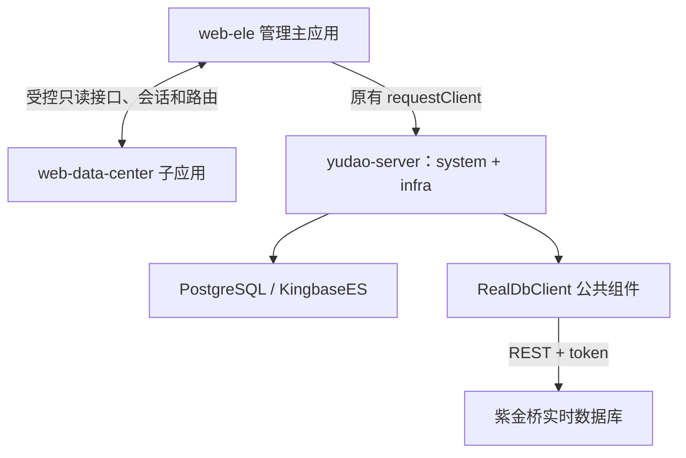

# New Data Center

## IoT 设备看板

数据中心子应用新增设备、测点映射、可配置看板和历史下载工作区，继续使用 qiankun 的正式挂载、会话更新与卸载机制。看板组件可绑定固定设备、多个设备，或跟随当前设备；统一指标键通过设备映射解析为紫金桥测点，不假定不同设备使用相同原始测点名。示例宿主仍与真实后端模式分离，演示数据不会被标记为现场数据。

后端新增 `yudao-module-iot`：可由 `yudao-server` 聚合，也可打包为独立 `exec` 微服务。设备、映射、看板布局与下载任务保存到关系数据库，实时/历史数据通过现有紫金桥客户端读取。独立运行仍需要项目既有的身份、权限和租户服务，不提供绕过登录的生产入口。

- [前端工作区、组件绑定和验证](docs/iot-frontend.md)
- [后端接口、增量数据库脚本和独立服务运行](docs/iot-backend.md)

新增数据库脚本需由管理员按部署环境审核并执行，不会在应用启动时自动迁移。此次开发不包括生产部署、设备写入或控制。紫金桥、金仓现场兼容性需要在指定版本与只读授权环境中另行验收；演示、契约替身和 PostgreSQL 测试不能替代现场验收。

基于仓库现有芋道 Java 17 后端和 Vue Vben 5 前端，增加 PostgreSQL / 人大金仓切换、qiankun 3.x 微前端，以及紫金桥实时数据库公共客户端。

默认组合为 **PostgreSQL + `yudao-server` 聚合后端 + `web-ele` 主应用 + `web-data-center` 子应用**。保留 system / infra 独立微服务代码和其他四套前端。详细设计、接口映射和验证方法见下方文档。

## 1. 目录与职责

| 目录 | 职责 |
| --- | --- |
| `yudao-cloud-mini-master-jdk17/` | 原有 Java 17 / Spring Boot / MyBatis Plus 后端 |
| `yudao-cloud-mini-master-jdk17/yudao-server/` | 本地默认启动入口，聚合 system、infra 和 realdb 客户端 |
| `yudao-cloud-mini-master-jdk17/yudao-framework/yudao-spring-boot-starter-realdb/` | 独立的紫金桥 REST API 公共模块 |
| `yudao-ui-admin-vben-master/apps/web-ele/` | 原有 Element Plus 管理端，现在也是 qiankun 主应用 |
| `yudao-ui-admin-vben-master/apps/web-data-center/` | 数据中心子应用：总览、部门目录和数据字典 |
| `yudao-ui-admin-vben-master/apps/web-micro-demo/` | 无需后端的 qiankun 3 集成示例宿主，使用明确标注的演示数据 |
| `yudao-ui-admin-vben-master/packages/micro-apps/` | 主子应用通信类型及挂载、更新、卸载调度 |
| [docs/database.md](docs/database.md) | 数据库配置、初始化、兼容性修复和迁移说明 |
| [docs/micro-frontends.md](docs/micro-frontends.md) | 微前端开发、通信、部署和测试说明 |
| [docs/micro-frontend-example.md](docs/micro-frontend-example.md) | 可运行的主子应用集成例子、操作步骤和代码说明 |
| [docs/realdb-api.md](docs/realdb-api.md) | 紫金桥配置、使用示例和全部 66 个操作映射 |



关系数据库保存平台业务数据；紫金桥是独立外部实时库。`querySql` 调用紫金桥的 `/api/SQL`，不会转发到 PostgreSQL 或金仓。新增子应用目前读取现有部门和字典接口；实时点值、历史曲线等业务页面可以在此基础上扩展。

## 2. 环境要求

| 组件 | 要求 |
| --- | --- |
| JDK | 17 |
| Maven | 3.9+ |
| Node.js | `^22.18.0` 或 `^24.12.0`，沿用前端工作区约束 |
| pnpm | `11.16.0`，以 `packageManager` 字段为准 |
| 业务数据库 | PostgreSQL；或 PostgreSQL 兼容模式的 KingbaseES |
| Redis | Redis 7，用于会话、缓存和消息 |
| 紫金桥 | 按需提供 REST 服务地址及账户，未启用时不需要该服务 |

## 3. 本地运行：PostgreSQL

以下命令先在仓库根目录执行。数据库密码由环境变量提供，仓库不保存实际环境凭据。

```bash
export DB_PASSWORD='请替换为你的本地数据库密码'
docker compose -f yudao-cloud-mini-master-jdk17/script/docker/docker-compose.postgresql.yml up -d

cd yudao-cloud-mini-master-jdk17
mvn -pl yudao-server -am -DskipTests package
java -jar yudao-server/target/yudao-server.jar
```

Compose 仅将 PostgreSQL 和 Redis 暴露到本机回环地址；数据库名默认 `ruoyi-vue-pro`、账户默认 `yudao`。首次创建空数据卷时执行仓库已有的 PostgreSQL 业务脚本和 Quartz 脚本。应用默认监听 `48080`，前端 API 前缀为 `/admin-api`。

**初始化脚本包含 `DROP TABLE` / `DROP SEQUENCE`，只用于全新数据库。** 已有业务库应先备份并制定迁移脚本。应用已设置 `spring.sql.init.mode=never`，启动不会自动覆盖数据库；重启 Compose 也不会重新初始化已有数据卷。此代码改造不包含生产数据迁移。

### 常用环境变量

| 变量 | 默认值 / 用途 |
| --- | --- |
| `SPRING_PROFILES_ACTIVE` | `postgresql`；切换金仓时设为 `kingbase` |
| `DB_HOST` | `127.0.0.1` |
| `DB_PORT` | PostgreSQL `5432` / KingbaseES `54321` |
| `DB_NAME` | `ruoyi-vue-pro` |
| `DB_SCHEMA` | `public` |
| `DB_USERNAME` | `yudao` |
| `DB_PASSWORD` | 必填 |
| `DB_JDBC_URL` | 可选；覆盖完整 JDBC URL，包括需要的 TLS / 厂商参数 |
| `REDIS_HOST` / `REDIS_PORT` | `127.0.0.1` / `6379` |
| `SPRING_DATA_REDIS_PASSWORD` / `REDIS_DATABASE` | 密码默认不配置 / `0` |
| `SERVER_PORT` | `48080` |
| `CAPTCHA_ENABLED` | `true`；本地自动化测试可关闭，前端需对应设置 |
| `API_DOCS_ENABLED` | `true`；按部署环境决定是否启用接口文档 |

账号、菜单等初始化数据沿用原项目。首次登录后应更改演示账户密码；连接已有环境时使用该环境实际账户。

### 聚合启动与独立微服务

`yudao-server/src/main/resources/application.yaml` 是不含实际凭据的版本化基础配置。默认禁用 Nacos、XXL-JOB 和远程 Feign，通过 `yudao.rpc.enabled=false` 注入聚合进程内已有的 API 实现，并拒绝对内部 RPC 路由的 HTTP 访问，避免绕过管理接口权限。

聚合模式还设置 `yudao.security.trust-login-user-header=false`，只通过正常 token 校验建立登录身份；外部传入的 `login-user` 身份头不会被信任。Nginx 示例在管理 API 和 WebSocket 两处代理中同时清除此头。独立微服务保留原可信网关透传模式，部署时应继续通过网关进入并限制服务直连。

原社交服务启动时需要微信客户端 Bean，因此配置了明确的 `local-disabled` 占位应用标识；不会据此进行微信登录。需要启用公众号 / 小程序功能时，通过 `WX_MP_APP_ID`、`WX_MP_SECRET`、`WX_MINIAPP_APP_ID`、`WX_MINIAPP_SECRET` 提供真实配置。

独立 system / infra 服务仍默认启用 Feign，需要各自的服务名、端口、Nacos 等外部配置。数据库配置可通过以下方式复用：

```yaml
spring:
  config:
    import: classpath:yudao-database-postgresql.yaml
```

金仓替换为 `classpath:yudao-database-kingbase.yaml`。不要将单体基础配置整体复制给微服务。

业务模块现在生成两类产物：普通 `*-server.jar` 供聚合应用依赖，`*-server-exec.jar` 供独立启动。对应 Dockerfile 已改用 `exec` 产物。

## 4. 切换人大金仓

在新建且已初始化的 KingbaseES 数据库上运行：

```bash
export SPRING_PROFILES_ACTIVE=kingbase
export DB_HOST=127.0.0.1
export DB_PORT=54321
export DB_NAME=ruoyi-vue-pro
export DB_SCHEMA=public
export DB_USERNAME=yudao
export DB_PASSWORD='请替换为你的金仓数据库密码'
java -jar yudao-server/target/yudao-server.jar
```

使用 `com.kingbase8.Driver` 和 `jdbc:kingbase8://`，不是仅将 PostgreSQL URL 改名。驱动版本沿用依赖管理中的 `kingbase.jdbc.version`，应与现场金仓版本核对，必要时在 Maven 构建时覆盖该版本。

SQL 使用 `sql/kingbase/` 中的原有脚本。适配目标为 **PostgreSQL 兼容模式**，Oracle / MySQL 兼容模式不在此次验证范围。切换 profile 仅切换连接和方言，不会自动复制另一数据库里的数据。

数据库层还修复了数值布尔字段与原生 `BOOL` 混用时的绑定、序列主键识别和限量删除 SQL。分页、代码生成 schema、Quartz delegate 等沿用并补齐原框架能力，详见 [数据库说明](docs/database.md)。

MySQL 驱动仍作为传递依赖打入可执行服务，支持原有 MySQL 部署，以及在 PostgreSQL / 金仓平台中配置 MySQL 外部数据源供代码生成使用；这不会改变默认数据库 profile。

## 5. qiankun 3.x 微前端与集成示例

当前精确锁定 `qiankun@3.0.0-rc.22` 和官方 `@qiankunjs/bundler-plugin@0.0.1-rc.2`。这是 3.x 预发布版本，依赖和 lockfile 均使用明确版本，升级时应重新验证生命周期和浏览器能力。子应用采用原生 ESM，样式隔离使用 `sandbox.styleIsolation` 和浏览器 CSS `@scope`。

这套 ESM 接入要求 Chrome / Edge 133+ 或 Safari 18.4+；Firefox 当前默认不满足动态多 import map 要求。具体浏览器条件及开发时手动刷新的限制见 [qiankun 官方浏览器说明](https://www.qiankunjs.com/guide/browser-support) 和 [本项目微前端说明](docs/micro-frontends.md)。

### 先运行无需后端的集成例子

在前端工作区执行：

```bash
cd yudao-ui-admin-vben-master
pnpm install --frozen-lockfile
pnpm dev:micro-demo
```

打开 `http://127.0.0.1:5174/`。示例宿主加载同一个 `web-data-center` 子应用，使用显式的演示数据桥接函数；可操作挂载、卸载、重新挂载、路由同步和租户切换，观察生命周期事件与数据更新。此例子不要求 Java、PostgreSQL、Redis 或管理端登录。

```bash
# 构建示例宿主和真实子应用
pnpm build:micro-demo

# 用生产构建产物复验集成
pnpm preview:micro-demo
```

完整例子及关键代码见 [微前端集成示例](docs/micro-frontend-example.md)。

### 启动接入真实后端的管理端

进入前端工作区：

```bash
cd yudao-ui-admin-vben-master
pnpm install --frozen-lockfile
cp config/web-ele.env.example apps/web-ele/.env.local

# 终端一：原生 Vite 子应用服务，默认 5175
pnpm dev:data-center

# 终端二：原 Element Plus 主应用，示例端口 5173
pnpm dev:ele
```

访问主应用、登录并打开“数据中心”。该入口兼容已有数据库菜单；部门和字典请求继续使用原后端的鉴权、租户和权限处理。前端示例将 `/admin-api` 代理到本机后端 `48080`。

实现要点：

- 主应用通过 qiankun `loadMicroApp` 加载子应用；保留原有登录、布局、权限菜单和请求拦截器。
- 子应用通过原生 ESM 导出 `bootstrap`、`mount`、`unmount`、`update`；官方 Vite 插件处理入口标记及开发、预览集成，开发和生产均使用模块入口。
- 主应用向子应用传递受控查询函数、显示用会话信息和路由，不向子应用传递紫金桥密码或原始访问令牌。
- 嵌入时使用内存路由，独立预览使用 hash 路由；宿主 URL 保存当前子视图，支持刷新恢复。
- 使用 qiankun 3 的 `sandbox: { styleIsolation: true }` 隔离子应用样式；页面离开、退出登录和切换租户时清理实例、监听和请求，避免旧会话响应回填。
- 子应用可独立预览；真实业务数据由登录后的主应用注入，无宿主时明确显示独立预览状态。

### 构建与部署

生产构建前将 `.env.local` 中的子应用入口改为：

```dotenv
VITE_GLOB_DATA_CENTER_ENTRY=/micro-apps/data-center/
```

```bash
pnpm build:micro
```

将 `apps/web-ele/dist/` 部署为站点根目录，将 `apps/web-data-center/dist/` 部署至 `/micro-apps/data-center/`。可参考 `scripts/deploy/nginx.micro.conf`；其中后端地址 `yudao-server:48080` 应替换为部署环境地址。子应用也可部署到独立域名，需设置正确入口和允许宿主访问的 CORS。

更多工作区命令、通信协议和新子应用接入步骤见 [微前端说明](docs/micro-frontends.md)。

## 6. 紫金桥独立公共模块

模块沿用 `yudao-spring-boot-starter-*`、`cn.iocoder.yudao.framework.*`、`config/core`、`*Properties`、`*DTO` 命名方式，并已接入聚合构建、BOM 和 `yudao-server`。其他服务只需依赖这个 starter；它不依赖 system / infra 业务模块，也不依赖 PostgreSQL 或金仓。

```xml
<dependency>
    <groupId>cn.iocoder.cloud</groupId>
    <artifactId>yudao-spring-boot-starter-realdb</artifactId>
</dependency>
```

默认不创建客户端、不连接外部实时库。通过外部配置启用：

```yaml
yudao:
  realdb:
    enabled: true
    base-url: ${REALDB_URL}
    username: ${REALDB_USERNAME}
    password: ${REALDB_PASSWORD}
    security-enabled: true
    connect-timeout: 5s
    read-timeout: 30s
    sync-timeout: 190s
```

```java
import cn.iocoder.yudao.framework.realdb.core.client.RealDbClient;
import com.fasterxml.jackson.databind.JsonNode;
import jakarta.annotation.Resource;
import org.springframework.boot.autoconfigure.condition.ConditionalOnProperty;
import org.springframework.stereotype.Service;

import java.util.List;

@Service
@ConditionalOnProperty(prefix = "yudao.realdb", name = "enabled", havingValue = "true")
public class RealtimeDataService {

    @Resource
    private RealDbClient realDbClient;

    public JsonNode getCurrentValues() {
        return realDbClient.getNamedData(List.of("A1.PV", "A2.PV"), null);
    }
}
```

### 覆盖范围

依据用户提供的 20260528 版《跨平台实时数据库 REST API》完成 **66 个文档操作**，部分操作共用 URL：

| 分组 | 操作数 | 范围 |
| --- | ---: | --- |
| 登录、登出 | 2 | 账户登录、令牌登出 |
| 数据读写 | 13 | 注册点名、实时数据、历史数据、报警和 SQL 查询 |
| 运行时组态 | 51 | 数据源、用户、组、串口、数据库设置、IO 设置、驱动、设备、目录、点和发布项 |

每个操作都有具名 Java 方法和文档章节对应关系。动态点类型及驱动参数使用 `JsonNode` 保留字段大小写和对象 / 数组结构，数据读写提供 DTO。返回值保留厂商 JSON，异常提供 HTTP 状态、业务码、响应和结果是否未知的信息。

客户端按厂商协议在查询参数传 token，缓存服务账户会话并保护并发登录。认证失效只清除会话；所有操作均不自动重放，避免注册、写值、删除和同步产生重复副作用。密码、token 和完整 URL 不进入异常消息。

**文档 5.11.4 的发布项修改 URL 有歧义**：原文为 `/api/export/name={ExportName}`，查询参数表又要求 `name`。默认采用 `/api/export?name=...`，并提供 `update-export-path` 配置兼容实际服务。上线前必须用现场紫金桥版本核对该接口。同步发布项允许 190 秒客户端等待，并将 HTTP 406 / 超时作为需核查服务端结果的情况处理。

公共模块提供 Java 调用能力，没有新增对浏览器公开的实时库 HTTP 透传入口。业务侧新增实时库页面时，应在已有 Controller / Service 体系中实现权限和操作审计。完整接口表、可配置项与异常语义见 [紫金桥说明](docs/realdb-api.md)。

## 7. 验证

```bash
# 后端：从后端根目录执行
mvn -pl yudao-server -am test
mvn -pl yudao-server -am -DskipTests package

# 前端：从前端工作区执行
pnpm check:micro
pnpm build:micro
```

独立示例提供真实浏览器回归：先运行 `pnpm dev:micro-demo` 或 `pnpm preview:micro-demo`，再于另一终端运行 `pnpm test:micro-demo`；首次使用先执行 `pnpm exec playwright install chromium`。开发和生产应各验证一次，详见 [集成示例测试说明](docs/micro-frontend-example.md#4-自动化回归)。

数据库实际连接测试需要显式提供测试库地址，命令见 [数据库回归说明](docs/database.md)。实时库测试使用本机 HTTP 模拟服务，覆盖全部文档操作的实际 HTTP 方法、路径、参数和请求体，以及认证、并发、超时、非 JSON 错误、中文名称编码和禁用自动配置。

### 本次实际验证结果

| 范围 | 结果 |
| --- | --- |
| PostgreSQL 16.9 初始化 | 业务与 Quartz 脚本导入成功：60 张表、48 个业务序列 |
| 后端构建 | `yudao-server` 及依赖的 26 个 Maven 模块构建通过；可执行 JAR 已实际启动 |
| 后端测试 | 显式连接测试数据库运行 108 项：数据库与驱动 13 项、紫金桥 84 项、安全 11 项，全部通过且无跳过 |
| 真实 HTTP 联调 | 使用本地初始化账户完成登录、权限、用户分页、通知未读数、部门、字典和代码生成元数据查询；部门 12 条、字典 1556 条 |
| 内部 RPC 防护 | 聚合模式下匿名和已认证 HTTP 请求均不能调用 system / infra 内部 RPC |
| 身份头 review 修复 | 真实过滤器 8 项回归通过；最终 JAR 的 HTTP 复验拒绝伪造身份头，合法 token 搭配伪造头时身份仍来自 token |
| JDBC review 修复 | 消费者级 3 项驱动发现测试通过；聚合、system、infra 三个实际可执行 JAR 均包含 MySQL / PostgreSQL / Kingbase 驱动 |
| 微前端 | 10 项生命周期、路由、会话及演示数据桥接测试通过；子应用与示例完整类型检查、宿主改动及其真实依赖的定向类型检查通过 |
| 前端构建与浏览器 | 主、子和示例应用构建通过；独立示例开发 / 生产模式及入口 503 后重试均通过。真实 PostgreSQL 管理端完成 qiankun 3 原生 ESM、CSS `@scope`、真实数据、切页、返回、刷新、快速重挂及退出清理验证，均无页面脚本错误 |

原管理端全量 `vue-tsc` 在上一轮因执行环境内存限制被终止，尚未完成所有原有业务页面的完整类型验收。原初始化菜单还有当前前端未包含的 CMS 页面，部分外部图片和图标也依赖外网；这些原有资源限制及本次测试范围详见 [微前端验证记录](docs/micro-frontends.md#本次验证)。

实机边界：PostgreSQL 已完成上述本地初始化与集成验证；人大金仓和紫金桥还需在现场指定版本、账户权限和网络环境下验收。测试替身通过不等于厂商实机联调通过。

## 8. 本次调整摘要

| 调整 | 原因与结果 |
| --- | --- |
| 两套数据库 profile 与共享配置 | 显式选择 PostgreSQL / KingbaseES，并将实际凭据移至环境变量 |
| 驱动、序列与 SQL 兼容 | 完整接入 JDBC 驱动，修复数值布尔字段和 PostgreSQL 不支持的删除语法 |
| 聚合启动基础配置 | 补齐原仓库未提交的启动配置，以本地 API 实现代替聚合进程中的 Feign 调用 |
| 业务模块双产物打包 | 修复嵌套可执行 JAR 导致业务类不可见，同时保留独立微服务运行方式 |
| qiankun 主子应用 | 在原管理端基础上提供可独立构建和部署的真实子应用 |
| qiankun 3 集成例子 | 原生 ESM 与官方 Vite 插件；提供不依赖后端的独立宿主和演示操作 |
| PR review 修复 | 恢复 MySQL 驱动传递依赖，并关闭聚合模式对外部身份头的信任 |
| realdb 公共 starter | 封装全部 66 个文档操作，统一认证、超时、协议校验和异常处理 |
| 文档与回归测试 | 补齐根 README、三个专题文档以及数据库 / 微前端 / HTTP 契约测试 |

原后端和前端目录中的 README 保留为上游参考；本仓库的启动与改造说明以本文件和 `docs/` 为准。
